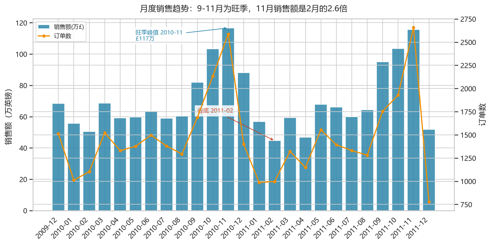
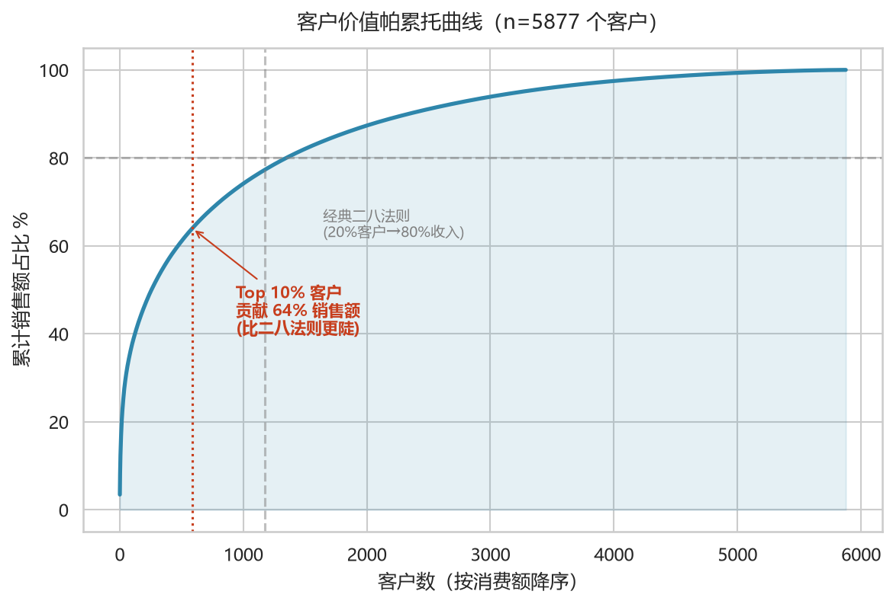
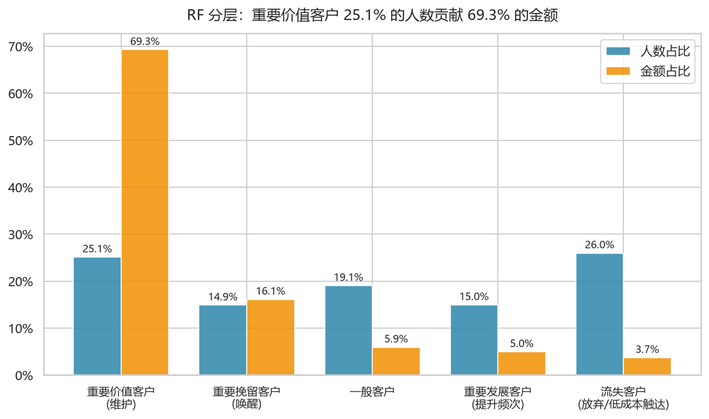
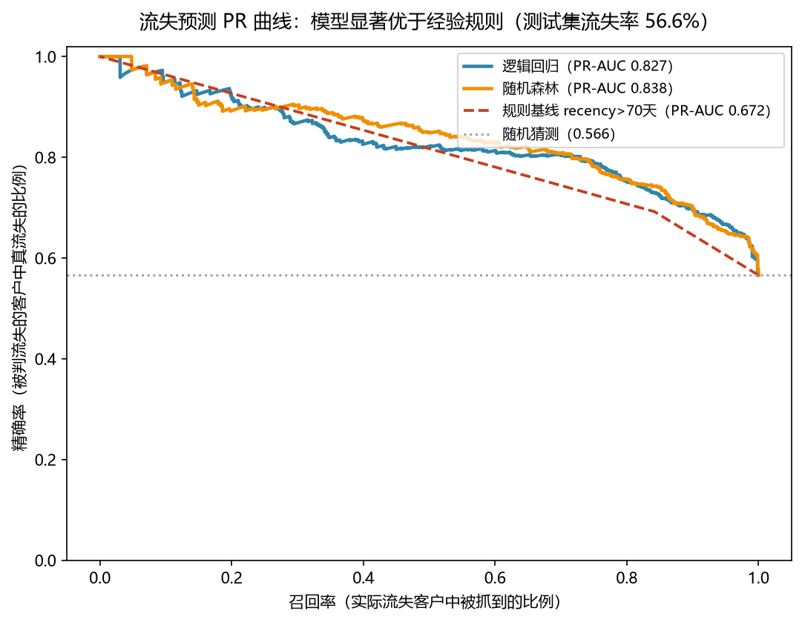
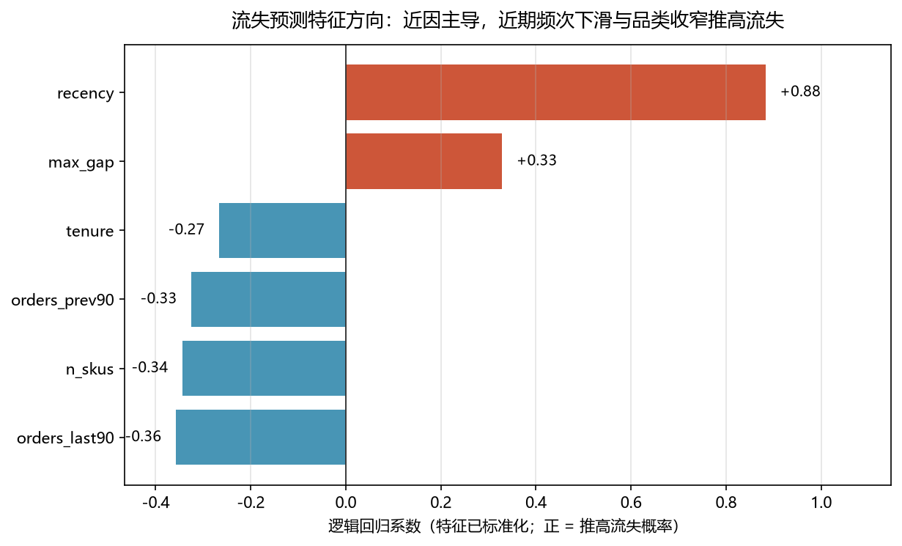

# 电商用户复购与流失分析报告

> 数据：UCI Online Retail II（英国在线零售商，2009-12 ~ 2011-12，106 万条原始交易）
> 分析：SQL（MySQL 8）+ Python（pandas / matplotlib）｜ 图表见 `charts/`

---

## 摘要

1. **客户价值极度集中**：Top 10% 的客户（588 人）贡献了 **64% 的销售额**，比经典"二八法则"更陡
2. **复购是生意的主体**：71.3% 的客户有 2 次以上购买行为；留存热力图显示大量新客"首月活跃、次月消失"（次月留存中位数 20.5%）。⚠️ 两个数字口径不同并不矛盾：71.3% 是**两年累计窗口**里"活跃 ≥2 天"的客户占比，20.5% 是**按月 cohort** 只看次月一个月的留存——前者衡量"最终是否回来过"，后者衡量"回来得多快"
3. **重要价值客户以 25.1% 的人数贡献 69.3% 的金额**；流失客户以 26.0% 的人数只贡献 3.7%
4. **召回时机有数据答案**：客户购买间隔中位数 31 天，80% 在 90 天内回购——**超过 70 天未回购的客户已进入流失高风险区**，是运营介入的最佳窗口
5. **季节性显著**：9–11 月为旺季，11 月销售额是 2 月谷底的 2.6 倍——营销资源应按季节倾斜
6. **流失可以提前预测**：用观测窗口内行为预测其后 90 天是否回购，逻辑回归 **PR-AUC 0.83**（随机猜测 0.57、经验规则 0.67）；按概率分四层后实际流失率 20%→52%→76%→90% 单调递增——运营可按层分配触达预算，而不是等客户"消失"再行动

---

## 一、背景与业务问题

某英国在线零售商（B2B/B2C 混合，主营礼品类），业务方关心三个问题：

- 客户买一次就走的多，**复购到底处于什么水平**？
- **哪些客户正在流失**？应该在什么时点介入召回？
- 有限的营销预算，**应该优先投给哪一类客户**？

本报告基于两年完整交易数据回答上述问题，并给出可执行的运营建议。

## 二、数据与口径

### 2.1 清洗漏斗（详见 `analysis/01_cleaning.py`）

| 环节 | 行数 |
|---|---|
| 原始数据 | 1,067,371 |
| 去重 | −12,133 |
| 剔除 Customer ID 缺失（游客单，无法归因到人） | −243,007 |
| 剔除退货/取消与异常单价 | −18,624 |
| **清洗后有效交易** | **793,607 行**（5,877 客户 / 36,967 订单 / £17,664,038） |

### 2.2 关键口径声明（重要）

- **一行 = 一张发票上的一行商品**，不是一张订单。订单数按 `invoice` 去重统计
- **复购率 = 有 ≥2 个不同下单日期的客户占比（71.3%）**。若按订单数口径会虚高（同一天多单、一单多行都会被误计为"复购"）
- RFM 观测终点为数据最后一天（2011-12-09），而非"今天"
- **定层只用 R / F 两个维度**（准确说是 RF 分层）：M 与 F 的秩相关达 0.86，收入基本是"买得多 × 买得贵"的结果，把 M 放进定层会对高频客户重复计权，还会把"大额低频"客户误判为高价值——因此 M 只作为金额描述列保留
- **退货/取消单整段剔除**（22,950 行负数量）：销售额未扣退货，口径偏乐观，见 §5 局限

## 三、发现

### 3.1 经营状况：明显的季节律动



- 9–11 月持续走旺，旺季峰值出现在 **2010-11（£117 万）**，2011-11 略低（£116 万）；全期谷底为 2011-02
- ⚠️ **2011-12 只有 9 天数据（不完整月）**，图中已灰化标注：其销售额与订单数骤降是月末截断，不代表真实回落，不参与趋势判断
- 两年节奏高度一致，说明季节性稳定、可预测——备货与营销预算应按此节奏前置安排

### 3.2 客户价值：比二八法则更陡的集中度



Top 10% 客户贡献 64% 销售额；**末 40% 的客户合计只贡献约 4%**。含义：少量大客户（结合数据中大量 B2B 特征，多为批发采购方）撑起营收基本盘——**保住头部客户的优先级高于拉新**。

### 3.3 RF 分层（R/F 定层，M 仅描述）：钱在哪、人在哪



| 分层 | 人数占比 | 金额占比 | 平均购买次数 | 平均距上次购买 |
|---|---|---|---|---|
| 重要价值客户（维护） | 25.1% | **69.3%** | 15.7 次 | 20 天 |
| 重要挽留客户（唤醒） | 14.9% | **16.1%** | 8.2 次 | 202 天 |
| 一般客户 | 19.1% | 5.9% | 2.5 次 | 226 天 |
| 重要发展客户（提升频次） | 15.0% | 5.0% | 2.3 次 | 26 天 |
| 流失客户（放弃/低成本触达） | 26.0% | 3.7% | 1.3 次 | 458 天 |

三个值得注意的结构：

- **重要挽留客户是被低估的资产**：仅占人数 14.9%，却贡献 16.1% 的金额——曾平均购买 8.2 次（高频），只是约 202 天没来。唤醒一个老客户的成本远低于获取新客，这一层是召回的第一优先级
- **重要发展客户 R 值极高（26 天）但 F 低**：刚买完不久、只买过 2–3 次——处于"习惯养成期"，此时推复购（如组合优惠）转化率最高
- **流失客户识别干净**：458 天未购 + 仅 1.3 次购买，投入产出比极低，建议低成本触达或放弃

### 3.4 留存：新客"首月繁荣"后的断崖


- 各 cohort **次月留存中位数 20.5%（范围 9–35%）**：大部分新客首月活跃、次月即消失
- 但留存下来的客户会**长期回访**（多条 cohort 在第 3–6 月出现回升并稳定）——留存曲线呈"断崖后长尾"形态
- 早期 cohort（2009-12）留存显著更好（首月后 35%），提示**获客质量可能随时间下降**，值得结合获客渠道做归因（数据限制，本报告仅提出假设）

### 3.5 购买间隔：召回时机的直接答案

对 4,189 个复购客户的相邻购买间隔统计：

| 分位数 | 25% | 50% | 75% | 90% |
|---|---|---|---|---|
| 间隔天数 | 13 | **31** | 70 | 147 |

- 一半的复购发生在 **31 天内**；**80.7% 在 90 天内**完成
- 因此：客户超过 **70 天**（75 分位）未回购即偏离自身习惯，进入流失高风险区；**90 天**是行业常用的"沉默"分界线，在本数据中也正好覆盖 80% 的正常回购

### 3.6 流失预测：把"预警线"升级成"打分模型"



**窗口设计（方法学核心）**：观测窗口 = 2009-12-01 ~ 2011-09-09，只用它造特征；
表现窗口 = 其后 90 天（2011-09-10 ~ 12-09），只用它定标签——表现窗口内没有任何购买记为流失（1）。
两窗完全分离，杜绝"用终点日算 recency 又用终点日算标签"的标签泄漏。

**特征**：6 个，全部取自观测窗口——`recency`（近因）、`max_gap`（最长购买间隔）、
`orders_last90` / `orders_prev90`（近期频次与动量）、`n_skus`（品类宽度）、`tenure`（客龄）。
候选特征做过共线性筛查：累计频次与活跃天数秩相关 0.99、月均频次与 recency −0.83，
直接入模会出现"买得越多越容易流失"的假系数，故剔除冗余、保留方向稳定的 6 个。

| 方法 | PR-AUC | ROC-AUC | 前 20% 覆盖率 | Lift@20% |
|---|---|---|---|---|
| **逻辑回归（主模型）** | **0.827** | 0.803 | 30.8% | 1.54 |
| 随机森林（对照） | 0.838 | 0.812 | 31.7% | 1.59 |
| 规则基线（recency>70 天） | 0.672 | 0.677 | 26.1% | 1.31 |
| 随机猜测 | 0.566 | — | 21.4% | 1.07 |

- 逻辑回归 5 折 CV PR-AUC **0.818 ± 0.012**，与随机森林接近——信号以线性为主，选可解释的逻辑回归做主模型
- F1 最优阈值 0.285：精确率 0.69、召回率 0.93（被判流失的客户里 7 成真流失，且抓得住 93% 的流失者）



系数方向全部符合业务直觉：**近因是最强信号**（+0.88）；最长间隔越长风险越高（+0.33）；
近 90 天订单数、品类宽度、客龄每增加一分风险越低（−0.36 / −0.34 / −0.27）。
"前 90–180 天订单数"为负意味着：**曾经活跃、近期骤停**的客户风险显著更高——这正是"重要挽留客户"的量化版本，与 §3.3 的分层结论互相印证。

**落地用法**（全量打分表 `data/churn_scores.csv`）：

| 风险层 | 客户数 | 占比 | 平均预测概率 | 实际流失率 |
|---|---|---|---|---|
| 低风险 | 1,278 | 24.2% | 0.15 | **20%** |
| 中风险 | 1,647 | 31.2% | 0.46 | 52% |
| 高风险 | 1,641 | 31.1% | 0.71 | 76% |
| 极高风险 | 714 | 13.5% | 0.86 | **90%** |

四层实际流失率单调递增，分层有效。运营含义：营销预算按层分配——极高风险优先人工/电话召回，
高风险用优惠券批量触达，中风险只做内容唤醒，低风险不打扰（避免过度营销反而触发流失）。

## 四、运营建议

| # | 建议 | 依据 | 预期动作 |
|---|---|---|---|
| 1 | 头部客户专属维护 | §3.2 Top 10% 贡献 64% | 客户经理制、大单专属折扣、缺货预警 |
| 2 | "重要挽留客户"定向唤醒 | §3.3 高频老客 191 天未归 | 优惠券 + 新品邮件召回，优先级最高的营销投放 |
| 3 | 新客 30 天黄金窗口 | §3.5 中位间隔 31 天；§3.4 次月留存 19% | 首购后 2–4 周内推二次复购激励（组合装/满减） |
| 4 | 建立流失预警线：70/90 天 | §3.5 间隔分位数 | 超 70 天未回购触发提醒；超 90 天转入低成本触达池 |
| 5 | 按流失概率分层触达 | §3.6 模型打分 | 极高风险（实际流失率 90%）人工召回；高风险（76%）优惠券批量触达；低风险（20%）不打扰 |
| 6 | 营销预算按季节倾斜 | §3.1 9–11 月旺季 | Q3 前置备货与投放，1–2 月谷底做客户关系维护而非拉新 |

## 五、局限与后续方向

1. **数据时效**：2009–2011 年数据，反映传统 B2C/目录电商场景；移动端与社交电商时代需重新验证
2. **B2B/B2C 混合**：数据含大量批发大单，客户分层实际上混合了企业与个人客户——后续可按订单规模拆分两类客户分别分析
3. **退货整段剔除**：销售额未扣退货，口径偏乐观；且"退货行为本身是否是流失信号"未被利用——后续应保留退货行并单独建模
4. **残月**：2011-12 仅 9 天数据，已灰化标注、不参与趋势判断；如需精确季节性结论，应对 2011-12 做月内日均折算或直接剔除
5. **RF 而非 RFM 定层**：M 与 F 秩相关 0.86，纳入定层会重复计权，故 M 仅作描述列（口径见 §2.2）
6. **流失阈值外推**：70/90 天预警线来自复购客户的间隔分位数；对只买过 1 次的客户，其"自身购买习惯"未知，预警线仅作参考
7. **无获客渠道字段**：无法做渠道归因；§3.4 的"早期 cohort 留存更好"仅为假设
8. **无成本数据**：所有"价值"均以收入衡量，未考虑毛利与获客成本
9. **流失模型的边界**：§3.6 只用了"截止 2011-09-10 + 90 天"单一时间切窗，训练/测试为同一窗口内的客户随机切分；更严谨的做法是滚动多窗口（逐季度前移切窗）验证时间稳定性。未纳入的特征：退货行为（本版清洗已剔除退货行）、获客渠道、商品价格带。进一步可用生存分析（Kaplan-Meier）替代固定窗口定义

## 六、复现方式

```bash
# 0. 安装依赖
pip install -r requirements.txt
# 1. 清洗（生成 data/clean_orders.csv；数据文件需先按 README 指引下载放入 data/）
python analysis/01_cleaning.py
# 2. 可视化（生成 charts/ 下前 4 张图与 data/rfm_customers.csv）
python analysis/02_visualize.py
# 3. 流失预测模型（生成 charts/05、06 与 data/churn_scores.csv，需 scikit-learn）
python analysis/03_churn_model.py
# 4. SQL 侧（可选）：导入 MySQL 后执行
#    sql/00_schema_and_import.sql → 01_core_metrics.sql → 02_rfm_and_retention.sql
```

环境：Python 3.11（pandas / numpy / matplotlib / seaborn / scikit-learn），MySQL 8.0（可选）
