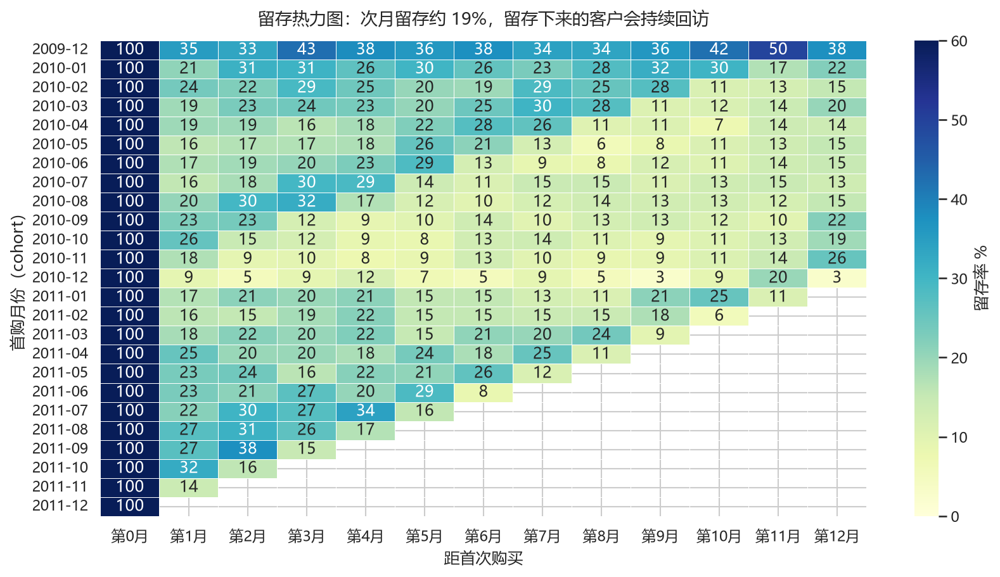

# 电商用户复购与流失分析报告

> 数据：UCI Online Retail II（英国在线零售商，2009-12 ~ 2011-12，106 万条原始交易）
> 分析：SQL（MySQL 8）+ Python（pandas / matplotlib）｜ 图表见 `charts/`

---

## 摘要

1. **客户价值极度集中**：Top 10% 的客户（588 人）贡献了 **64% 的销售额**，比经典"二八法则"更陡
2. **复购是生意的主体**：71.3% 的客户有 2 次以上购买行为，但留存热力图显示大量新客"首月活跃、次月消失"（次月留存约 19%）
3. **重要价值客户以 25% 的人数贡献 69% 的金额**；流失客户以 26% 的人数只贡献 3.7%
4. **召回时机有数据答案**：客户购买间隔中位数 31 天，80% 在 90 天内回购——**超过 70 天未回购的客户已进入流失高风险区**，是运营介入的最佳窗口
5. **季节性显著**：9–11 月为旺季，11 月销售额是 2 月谷底的 2.6 倍——营销资源应按季节倾斜

---

## 一、背景与业务问题

某英国在线零售商（B2B/B2C 混合，主营礼品类），业务方关心三个问题：

- 客户买一次就走的多，**复购到底处于什么水平**？
- **哪些客户正在流失**？应该在什么时点介入召回？
- 有限的营销预算，**应该优先投给哪一类客户**？

本报告基于两年完整交易数据回答上述问题，并给出可执行的运营建议。

## 二、数据与口径

### 2.1 清洗漏斗（详见 `analysis/01_cleaning.py`）

| 环节 | 行数 |
|---|---|
| 原始数据 | 1,067,371 |
| 去重 | −12,133 |
| 剔除 Customer ID 缺失（游客单，无法归因到人） | −243,007 |
| 剔除退货/取消与异常单价 | −18,624 |
| **清洗后有效交易** | **793,607 行**（5,877 客户 / 36,967 订单 / £17,664,038） |

### 2.2 关键口径声明（重要）

- **一行 = 一张发票上的一行商品**，不是一张订单。订单数按 `invoice` 去重统计
- **复购率 = 有 ≥2 个不同下单日期的客户占比（71.3%）**。若按订单数口径会虚高（同一天多单、一单多行都会被误计为"复购"）
- RFM 观测终点为数据最后一天（2011-12-09），而非"今天"

## 三、发现

### 3.1 经营状况：明显的季节律动


- 9–11 月持续走旺，**11 月为全年峰值（£117 万）**，12 月起回落；1–2 月为谷底
- 两年节奏高度一致，说明季节性稳定、可预测——备货与营销预算应按此节奏前置安排

### 3.2 客户价值：比二八法则更陡的集中度


Top 10% 客户贡献 64% 销售额；**末 40% 的客户合计只贡献约 4%**。含义：少量大客户（结合数据中大量 B2B 特征，多为批发采购方）撑起营收基本盘——**保住头部客户的优先级高于拉新**。

### 3.3 RFM 分层：钱在哪、人在哪


| 分层 | 人数占比 | 金额占比 | 平均购买次数 | 平均距上次购买 |
|---|---|---|---|---|
| 重要价值客户（维护） | 25.1% | **69.3%** | 14.8 次 | 20 天 |
| 重要挽留客户（唤醒） | 15.0% | 5.0% | 8.8 次 | 191 天 |
| 一般客户 | 19.1% | 5.9% | 2.7 次 | 209 天 |
| 重要发展客户（提升频次） | 12.9% | 4.0% | 2.0 次 | 26 天 |
| 流失客户（放弃/低成本触达） | 26.0% | 3.7% | 1.3 次 | 455 天 |

三个值得注意的结构：

- **重要挽留客户是被低估的资产**：他们曾平均购买 8.8 次（高频），只是 191 天没来。唤醒一个老客户的成本远低于获取新客，这一层是召回的第一优先级
- **重要发展客户 R 值极高（26 天）但 F 低**：刚买完不久、只买过 2 次——处于"习惯养成期"，此时推复购（如组合优惠）转化率最高
- **流失客户识别干净**：455 天未购 + 仅 1.3 次购买，投入产出比极低，建议低成本触达或放弃

### 3.4 留存：新客"首月繁荣"后的断崖



- 各 cohort **次月留存约 15–25%**：大部分新客首月活跃、次月即消失
- 但留存下来的客户会**长期回访**（多条 cohort 在第 3–6 月出现回升并稳定）——留存曲线呈"断崖后长尾"形态
- 早期 cohort（2009-12）留存显著更好（首月后 35%），提示**获客质量可能随时间下降**，值得结合获客渠道做归因（数据限制，本报告仅提出假设）

### 3.5 购买间隔：召回时机的直接答案

对 4,189 个复购客户的相邻购买间隔统计：

| 分位数 | 25% | 50% | 75% | 90% |
|---|---|---|---|---|
| 间隔天数 | 13 | **31** | 70 | 147 |

- 一半的复购发生在 **31 天内**；**80.7% 在 90 天内**完成
- 因此：客户超过 **70 天**（75 分位）未回购即偏离自身习惯，进入流失高风险区；**90 天**是行业常用的"沉默"分界线，在本数据中也正好覆盖 80% 的正常回购

## 四、运营建议

| # | 建议 | 依据 | 预期动作 |
|---|---|---|---|
| 1 | 头部客户专属维护 | §3.2 Top 10% 贡献 64% | 客户经理制、大单专属折扣、缺货预警 |
| 2 | "重要挽留客户"定向唤醒 | §3.3 高频老客 191 天未归 | 优惠券 + 新品邮件召回，优先级最高的营销投放 |
| 3 | 新客 30 天黄金窗口 | §3.5 中位间隔 31 天；§3.4 次月留存 19% | 首购后 2–4 周内推二次复购激励（组合装/满减） |
| 4 | 建立流失预警线：70/90 天 | §3.5 间隔分位数 | 超 70 天未回购触发提醒；超 90 天转入低成本触达池 |
| 5 | 营销预算按季节倾斜 | §3.1 9–11 月旺季 | Q3 前置备货与投放，1–2 月谷底做客户关系维护而非拉新 |

## 五、局限与后续方向

1. **数据时效**：2009–2011 年数据，反映传统 B2C/目录电商场景；移动端与社交电商时代需重新验证
2. **B2B/B2C 混合**：数据含大量批发大单，客户分层实际上混合了企业与个人客户——后续可按订单规模拆分两类客户分别分析
3. **无获客渠道字段**：无法做渠道归因；§3.4 的"早期 cohort 留存更好"仅为假设
4. **无成本数据**：所有"价值"均以收入衡量，未考虑毛利与获客成本
5. **后续方向**：用生存分析（Kaplan-Meier）替代固定天数阈值定义流失；构建流失预测模型（逻辑回归/XGBoost）输出客户流失概率分

## 六、复现方式

```bash
# 1. 清洗（生成 data/clean_orders.csv）
python analysis/01_cleaning.py
# 2. 可视化（生成 charts/ 下 4 张图与 data/rfm_customers.csv）
python analysis/02_visualize.py
# 3. SQL 侧（可选）：导入 MySQL 后执行
#    sql/00_schema_and_import.sql → 01_core_metrics.sql → 02_rfm_and_retention.sql
```

环境：Python 3.11（pandas / matplotlib / seaborn），MySQL 8.0（可选）
